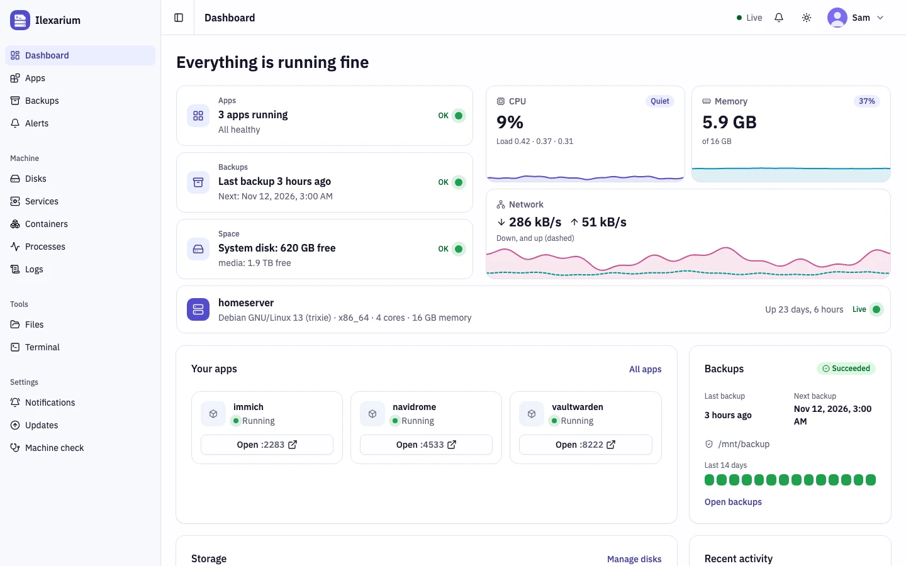

<p align="center">
  <picture>
    <source media="(prefers-color-scheme: dark)" srcset="brand/ilexarium-logo-dark.svg">
    
  </picture>
</p>

<p align="center">
  Ilexarium makes running your own home server easy enough for anyone, and never gets in the way
  of those who already know how.
</p>

<p align="center">
  <picture>
    <source media="(prefers-color-scheme: dark)" srcset=".github/readme/dashboard-dark.webp">
    
  </picture>
</p>

Ilexarium installs onto an existing Linux machine and lets you run your own apps, and the machine
itself, from the browser.

- **Apps** from ready templates or your own Compose file: install, change, update, remove.
- **Backups** with Borg to a disk of your choice, every day, encrypted, and restores from the same page.
- **The machine:** disks, processes, files and a terminal in the browser.
- **Health alerts** by email or ntfy when an app stops or a disk fills up.
- **Updates** of Ilexarium itself, checked as genuine before they install.
- **No root of its own:** it acts as you, with your own Linux account and your own `sudo`.
- English, German and Arabic.

## Install

Debian 12 or 13, Ubuntu 26.04 or Arch Linux. Ubuntu 24.04 too, with [Borg 1.4](https://borgbackup.readthedocs.io/en/1.4-maint/installation.html) installed first (Ubuntu 24.04 has only Borg 1.2):

```sh
curl -fsSL https://ilexarium.com/get-ilex.sh -o get-ilex.sh
less get-ilex.sh    # read it first, and check its key line is exactly the one below
bash get-ilex.sh
```

The key that signs every Ilexarium release, as `get-ilex.sh` carries it:

    PUBLIC_KEY='RWTCTN0pOPdJ/mpJjRirU77qRxeSGPL7lzj5u5xSeDlZSvyd+AU+1QVg'

Ilexarium listens on `127.0.0.1:3000` (and `[::1]:3000`, so `localhost` works too); you reach it
through an HTTPS proxy of your choice.
Guides: [ilexarium.com](https://ilexarium.com).

## Development

Node 26+, npm 12+, Docker:

```sh
npm install
npm run db:up        # Postgres
npm run dev:server   # API on :3000
npm run dev:web      # UI on :4200
```

How the repository is laid out and the safety rules: [`CONTRIBUTING.md`](CONTRIBUTING.md).
Security problems: [`SECURITY.md`](SECURITY.md).

## Licence

Free software under the [GNU GPL, version 3 or later](LICENSE), without any warranty.
